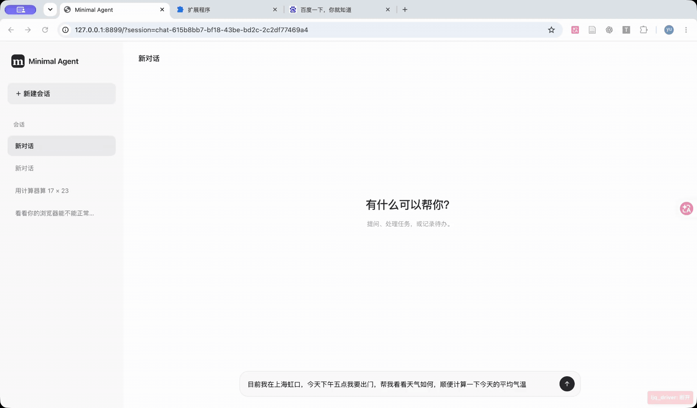

# Minimal Agent

一个用 Python 标准库实现核心循环的本地 Agent，支持工具调用、会话续接、上下文裁剪和历史问答召回。**推荐使用 Web GUI**，可以直接查看聊天记录、工具结果、计划和待办。

架构设计题的回答见 [架构设计题.md](架构设计题.md)。

## Demo



[demo/](demo/) 还包含三张示例截图：[执行计划进度](demo/plan-progress.png)、[长期记忆约定触发天气查询和待办](demo/memory-trigger-weather-todo.png)、[历史问答召回](demo/history-recall.png)。

## 快速开始

### 环境要求

| 项目 | 要求 |
| --- | --- |
| Python | 3.10 或更高版本 |
| 模型服务 | 支持 Chat Completions 工具调用的 API，配置示例使用 DeepSeek |
| Chrome/edge | 仅使用浏览器搜索或网页操作时需要 |

在项目根目录执行以下命令前，可用 `python3 --version` 确认当前终端使用的 Python 版本。如果低于 3.10，请先切换到符合要求的解释器。

### 浏览器搜索准备（可选）

只有要演示网页搜索或操作网页时，才需要完成下面的准备。首次使用时，在项目根目录安装浏览器桥接依赖。

```sh
python3 -m venv .venv-browser
.venv-browser/bin/python -m pip install -r requirements-browser.txt
```

在 Chrome 的扩展管理页开启开发者模式，选择「加载已解压的扩展程序」，加载 `browser/extension/`。保持至少一个普通网页标签页打开。之后正常启动 Web GUI 或 CLI，再让 Agent 在浏览器里搜索。首次调用浏览器工具时会按需启动桥接服务，已有兼容服务时直接复用。默认使用 WebSocket 18765 和 HTTP 18766 端口。Windows 下虚拟环境的 Python 路径为 `.venv-browser\Scripts\python.exe`。

如果没有安装依赖，浏览器工具会返回安装提示。如果桥接已启动但没有可用标签页，工具会提示检查 Chrome 扩展和网页标签。可以继续在同一会话中使用其他工具。

### 配置 API 并启动 Web GUI

1. 复制配置模板。已有 `api_config.local.json` 时跳过这一步。

   ```sh
   cp api_config.example.json api_config.local.json
   ```

2. 打开 `api_config.local.json`，填写 `api_key`。示例已配置 DeepSeek 的地址和模型。
3. 启动 Web GUI。

   ```sh
   python3 -m frontends.server
   ```

打开 `http://127.0.0.1:8899/`，发送「用计算器算 17 × 23」，确认能调用工具并返回 **391**。基础聊天和计算可以直接使用。网页搜索需要额外连接浏览器扩展。

## 运行方式

| 场景 | 命令 |
| --- | --- |
| Web GUI（推荐） | `python3 -m frontends.server` |
| Web 更换端口 | `python3 -m frontends.server --port 8900` |
| 终端交互 | `python3 agent.py` |
| 终端续接指定会话 | `python3 agent.py --session window-1` |

CLI 输入 `/help` 可以查看命令。常用命令有 `/new`、`/sessions`、`/switch 名称` 和 `/exit`。Web 与 CLI 默认共用 `data/` 中的会话。切换到已有会话即可续聊，计划和待办也会随会话恢复。会话锁是进程内的，运行时请避免在两个入口同时写同一个会话。

### API 配置

两个入口都支持 `--config 路径` 指定配置文件。也可以设置 `LLM_API_KEY`、`LLM_BASE_URL`、`LLM_MODEL`，环境变量优先。换用其他兼容服务时，填写其 API 基址和模型名，并按服务支持情况调整 `request_options`。客户端会在基址后追加 `/chat/completions`。本地配置已加入 Git 忽略规则。

出现连接超时时，可通过 `proxy_mode` 选择 `system`（使用系统代理）或 `direct`（直连），通过 `timeout` 调整单次请求超时。

文件读写和代码执行默认以 `temp/` 为相对路径起点，以本机用户权限运行。

## 文件组织

| 文件或目录 | 职责 |
| --- | --- |
| `agent.py`、`cli.py` | CLI 入口、依赖组装和本地会话命令 |
| `frontends/` | Web 服务、聊天界面和静态资源 |
| `runtime.py` | Agent 循环，调度模型请求和工具执行 |
| `client.py` | Chat Completions 请求、响应解析和网络重试 |
| `session.py` | 会话持久化、执行权和取消，记录本轮消息 |
| `context.py`、`system_prompt.txt` | 请求组装、预算裁剪和提示词模板 |
| `memory.py` | 提取和更新滚动摘要 |
| `tools/` | 工具注册与 Schema 校验，具体工具在 `tools/builtin/` |
| `browser/` | 浏览器客户端、桥接服务和 Chrome 扩展 |
| `data/`、`temp/` | 本地会话数据和工具工作目录，运行时使用 |
| `tests/`、`reports/` | 测试和历史验收报告 |

## 系统设计

### Runtime

一轮从用户输入开始。Runtime 组装上下文，将消息和工具 Schema 交给模型。模型直接回复时结束本轮。模型发起工具调用时，Runtime 通过注册表执行工具，按调用 ID 回填结果，再发起下一次模型请求。

同一会话的执行由 `SessionStore` 串行协调。工具调用先保存结果占位，执行完后回填并落盘。取消时会检查执行身份，避免已取消的执行继续提交旧结果。默认最多 40 步。前 20 步均进入工具执行时，第 21 次模型请求会提醒模型核对进展，卡住时考虑换方法。

### 工具

每个内置工具独立声明名称、描述、参数 Schema 和执行函数。注册表负责解析参数、校验 Schema 和分发调用。新增工具可以放进 `tools/builtin/` 并注册，Runtime 继续走同一条执行路径。

| 工具 | 用途 |
| --- | --- |
| `calculator` | 计算算术表达式 |
| `file_read` | 按行或关键词读取本地文件 |
| `file_write` | 写入、追加或在开头插入文件内容 |
| `code_run` | 执行 Python 或 Shell，返回输出和退出码 |
| `todo` | 新增、查询、完成或删除用户待办 |
| `plan` | 创建、查询、更新或取消 Agent 执行计划 |
| `ask_user` | 请求用户澄清需求或选择方案 |
| `update_working_checkpoint` | 更新当前任务的目标、约束和进度便笺 |
| `recall_history` | 按关键词查历史问答，返回片段和原文位置 |
| `web_scan` | 列出已连接的标签页或读取页面快照 |
| `web_execute_js` | 在指定标签页中执行 JavaScript |

搜索由 `web_scan` 和 `web_execute_js` 组合完成。Agent 可以提交查询、读取结果并打开来源页面。

### 上下文压缩

模型在正常回复中顺带输出简短的 `<summary>`。程序提取摘要并维护有长度上限的滚动记录。模型漏写时用正文摘录。超预算时直接复用已经积累的摘要，省去临时发起总结请求的等待。

每次模型请求前按字符估算消息和工具 Schema 的大小。超限时先从请求副本裁剪较早的完整会话轮次，必要时再移除当前轮较早的完整工具批次，保留当前用户输入和最新工具批次。完整会话 JSON 仍是 Web 界面渲染和会话续接的数据来源。

### 记忆的放置与召回

| 层级 | 保存与放置 | 使用时机 |
| --- | --- | --- |
| 工作记忆 | 滚动摘要、检查点和当前计划随会话保存，每次请求在会话消息末尾组装一份 `【工作记忆】` | 当前任务需要接续进度、约束或近期结论时 |
| 长期笔记 | 跨会话共享的 `data/memory.md`，不超过 1200 字符的笔记随工作记忆带入，较长笔记通过文件工具读取 | 回应前检查是否匹配用户偏好或触发约定，用户明确要求长期记住时更新 |
| 历史归档 | 完整会话 JSON，按需通过只读工具 `recall_history` 检索 | 用户提到以前问过的问题，或当前上下文缺少旧对话细节时 |

`recall_history` 用关键词匹配历史问答，优先比较旧问题的命中，再看回答命中和会话更新时间。最多返回五条候选，每条包含旧问题、回答片段、会话名、会话更新时间、轮次和日志路径。片段不足时可以沿日志路径回读原文。同义改写可能需要换关键词。普通续聊直接使用当前会话的消息和工作记忆。

## 测试与开发记录

在项目根目录运行离线测试。测试使用模拟模型和浏览器服务，以及临时目录中的本地工具。

```sh
python3 -m unittest discover -s tests -q
```

[Codex 工作上下文总结和问题解决记录](<Codex 工作上下文总结和问题解决记录.md>)
